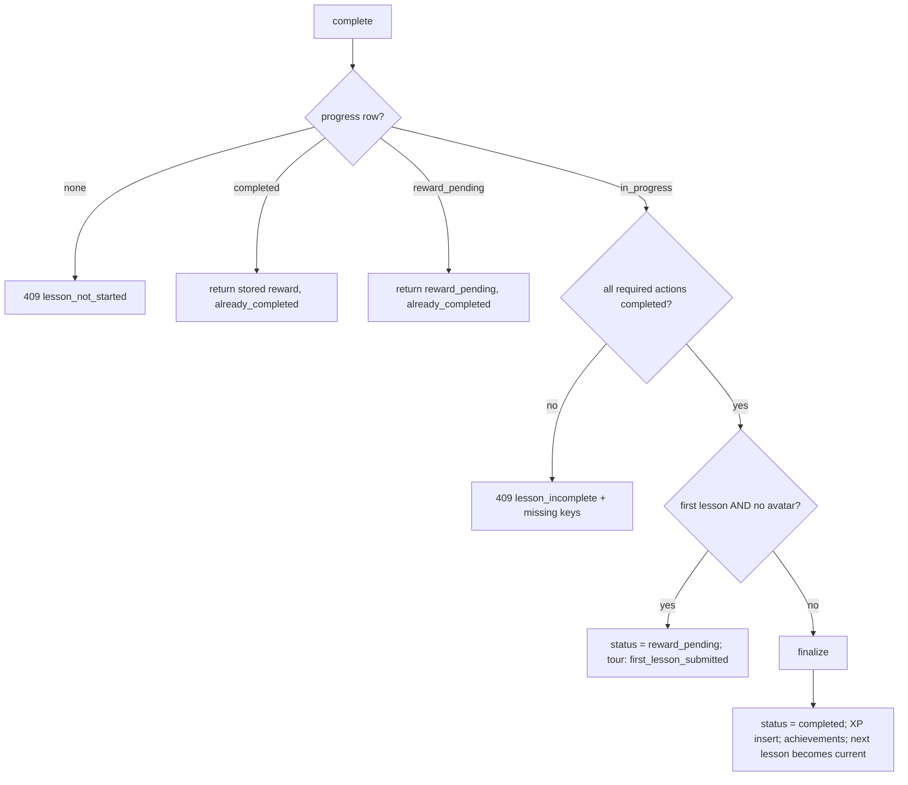

# Action engine

An **action** is one thing a learner does inside a lesson. Content declares actions; the backend
executes them. Code: `modules/actions/handlers.py` (handlers), `modules/progression/engine.py`
(pure rules), `modules/progression/service.py` (orchestration and rewards).

## Contract

```python
@dataclass
class ActionContext:          # what a handler receives
    user_id: UUID
    lesson: Lesson            # validated content
    action: Action            # this action's validated configuration
    payload: dict             # untrusted learner input
    states: dict[str, ActionState]   # current state of every action in the lesson
    freelancer: FreelancerService
    ai: AiService

@dataclass
class ActionOutcome:          # what a handler returns
    completed: bool           # is the completion strategy satisfied now?
    payload: dict             # normalized input (stored)
    result: dict              # outcome shown to the learner (stored)
    asset_created: bool = False

Handler = Callable[[ActionContext], Awaitable[ActionOutcome]]
HANDLERS: dict[str, Handler]  # the registry, keyed by action type
```

A handler validates input and reports completion. It never awards XP, unlocks lessons or commits.

## Handlers

| Type | Payload | Validation | Completed when | Result |
|---|---|---|---|---|
| `acknowledge` | `{}` | – | always (`manual_confirmation`) | `{}` |
| `text_submission` | `{"values": {field: text}}` | every field present, trimmed, within `min_length`/`max_length` | input valid (`valid_submission`) | `{}` |
| `quiz` | `{"answers": {question: option}}` | every question answered with a real option | `score ≥ passing_score` (`quiz_passing_score`) | score, per-question review with explanations |
| `ai_review` | `{}` | source submission exists | feedback returned (`ai_feedback_received`) | validated feedback, generation id |
| `external_task` | `{"count": n}` | integer, 0 ≤ n ≤ `target_count` | `n ≥ target_count` (`self_reported_count`); smaller counts are saved as progress | count, target |
| `save_asset` | `{}` | source submission exists | asset stored (`asset_exists`) | asset id, type, revision |

Errors: `422 invalid_submission` (with `details.fields`), `409 dependency_not_met` (with
`details.requires`), `503 ai_unavailable`, `429 ai_limit_reached`.

## Submit flow

`POST /api/v1/journey/lessons/{lesson_id}/actions/{action_key}` with `{"payload": {...}}`

1. Load profile and path; the lesson must be `current` or `done` (`403 lesson_locked`) and playable.
2. Load action states (newest attempt per action).
3. Check `depends_on` and `source_action_key` are completed.
4. Run the handler.
5. Insert an `action_attempts` row (payload, result, completed, content version); make sure the
   lesson snapshot and progress row exist.
6. If an asset was created, evaluate achievements.
7. Commit. Return the action, all action states, `completable`, `missing_required`, new achievements.

State rules: an action's state is its newest attempt, except that a completed action stays completed
after a later failed attempt (a failed quiz retake does not undo a pass). `stale` is true when the
source text was resubmitted after an `ai_review` or `save_asset` last ran, so the UI can say
"your draft changed since the last save".

## Completion policy

`POST /api/v1/journey/lessons/{lesson_id}/complete`



- A lesson is completable when every `required` action is completed. Optional actions (AI feedback)
  never block: if AI is down, the learner still finishes. That is the "manual completion" path.
- The frontend cannot mark anything complete. `completable` is advisory; the server re-checks.
- Availability is sequential (`engine.lesson_statuses`): completed lessons are `done`, the first
  unfinished one is `current`, the rest `locked`. A `reward_pending` lesson is still `current`, so the
  next lesson stays locked until the reward is paid.

## XP and achievements

- XP amount comes from the lesson (`xp`) at the time of payment and is written to the `xp_events` ledger
  with the key `lesson:<lesson_id>:completed`. A user's total is the sum of their rows.
- `_finalize` is the only code that pays XP. It is reached from `complete_lesson` and from
  `select_avatar` (for parked rewards).
- Achievements are data in the learning path; triggers are checked after a lesson is finalized and
  after an asset is created.

## Idempotency

| Call repeated | Effect |
|---|---|
| `…/start` | none (insert-or-ignore) |
| `…/actions/{key}` | a new attempt row; no reward change |
| `…/complete` | returns the stored state; no second XP row |
| `PUT /me/avatar` | avatar updated; reward paid only if one was pending |
| `POST /tour/events` | no-op unless the event matches the current stage |

## Adding an action type

1. Add a Pydantic model with a `type` literal and a `completion` literal to `curriculum/schemas.py`,
   and add it to the `Action` union. Add new strategies to `IMPLEMENTED_STRATEGIES`.
2. Write a handler and register it in `HANDLERS`.
3. Add the learner-safe config in `progression/presenters.py::_action_config`.
4. Add the Studio object type (`studio/schemas/actions.ts`), its GROQ projection and type-name mapping
   (`infrastructure/cms/sanity.py`).
5. Add a component in `components/lessons/actions.tsx`.

Until step 1–2 exist, a lesson using the type is rejected by validation and shown as "coming soon".

## Daily challenges reuse the engine

`modules/gamification/daily.py` runs a challenge's single action through the same `HANDLERS` registry
with `lesson=None` (`external_task`, `acknowledge`, `text_submission` and `quiz` are allowed there).
Daily challenges are real-world tasks with a count: the learner ticks a box each time, every tick is
saved on the day's entry, and reaching the target completes the challenge. The count is self-reported
and the UI says so; the app does not claim to verify outreach it cannot see. Completion pays
the challenge's XP through the ledger with the key `daily:<local date>` and records the activity day.
`POST /daily/submit` is idempotent once the day's challenge is completed.

Completing any lesson action also records the activity day, so working on a lesson keeps the streak.
`RewardOut` and `DailySubmitOut` carry `rank` and `rank_up`, computed from XP before and after.
