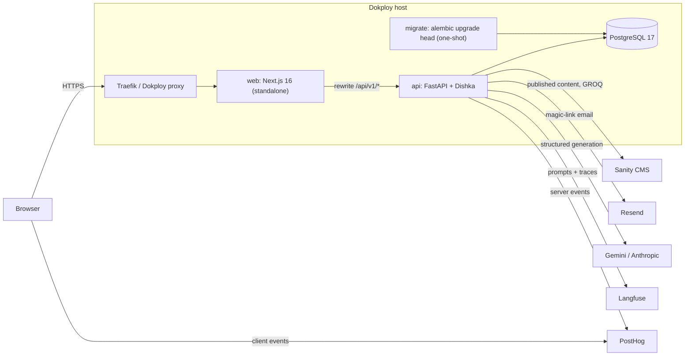
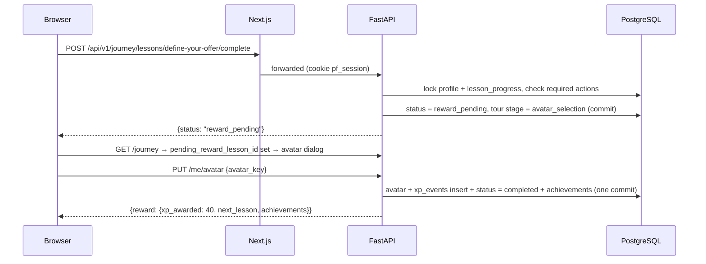

# Architecture

PeopleForce is a modular monolith: one Next.js app, one FastAPI service, one PostgreSQL database.
Editorial content, email, analytics, prompts and the language model are managed services behind adapters.

## System overview

The browser only ever talks to the web origin. `/api/v1/*` is forwarded to FastAPI by a Next.js rewrite
(`next.config.ts`), so cookies are first-party, there is no CORS, and the API is never exposed publicly.

## Repository layout

| Path | What it is |
|---|---|
| `app/`, `components/`, `lib/` | Next.js app (App Router, Cache Components). Kept at the repo root, where it already was. |
| `app/globals.css` | The design system (unchanged visual language). New screens append to it. |
| `app/tailwind.css` | Tailwind v4 utilities, no preflight, tokens mapped to the same CSS variables. |
| `api/` | FastAPI service (`src/peopleforce`), Alembic migrations, tests, seed content (`content/`). |
| `studio/` | Sanity Studio: schema for domains, paths, chapters, lessons, blocks, actions. |
| `e2e/` | Playwright test of the first-run journey. |
| `prototype/`, `design/` | The original static prototype and design sources (reference only). |
| `docker-compose.yml` | Production stack for Dokploy. `docker-compose.dev.yml` runs only Postgres for development. |

## Backend modules

`api/src/peopleforce/`

| Module | Owns | Depends on |
|---|---|---|
| `core` | settings, DB base, errors, token hashing, logging | – |
| `di` | Dishka providers: APP scope (engine, adapters), REQUEST scope (session, services, current user) | everything |
| `infrastructure/email` | `EmailSender` protocol; Resend and console senders | – |
| `infrastructure/cms` | Sanity GROQ adapter | – |
| `infrastructure/ai` | `LlmProvider` protocol (Gemini, Anthropic); prompt store (Langfuse + local files) | – |
| `infrastructure/analytics` | `Analytics` protocol (PostHog, no-op) | – |
| `modules/auth` | users, sessions, magic-link challenges | onboarding, curriculum |
| `modules/onboarding` | quiz definition, anonymous drafts, personalization profile, claim | freelancer |
| `modules/curriculum` | typed content model, loading, validation, caching, fallback | infrastructure/cms |
| `modules/actions` | action handler registry (one handler per action type) | ai, freelancer |
| `modules/progression` | journey state, lesson access, completion, rewards, HTTP for journey/lessons/avatar/tour | all of the below |
| `modules/gamification` | XP ledger, achievements, ranks, streaks, daily challenge (+ HTTP for daily, profile, time zone) | curriculum, actions |
| `modules/tours` | first-run tour state machine | – |
| `modules/freelancer` | profile, assets, AI platform drafts | ai |
| `modules/ai` | capability registry, prompts, `AiService`, audit rows | freelancer |

Each module has only the files it needs (`api.py`, `schemas.py`, `models.py`, `service.py`). There is no
repository layer: services use the SQLAlchemy session directly, which keeps transactions visible.

**Transaction rule.** One request gets one `AsyncSession` (Dishka REQUEST scope). The *use-case* service
(`AuthService`, `OnboardingService`, `ProgressionService`, `AssetDraftService`) commits; helper services
(`FreelancerService`, `GamificationService`, `TourService`) never commit, so a use case is one transaction.
Anything left uncommitted is rolled back when the request ends.

**Adaptix** converts between JSONB and the `PersonalizationProfile` dataclass (`onboarding/quiz.py`).
ORM → HTTP DTOs are plain functions or Pydantic `from_attributes`; a generic converter over ORM
relationships would hide more than it saves.

## Frontend structure

| Path | Role |
|---|---|
| `app/page.tsx` | Landing (Server Component, static). |
| `app/start`, `app/start/plan` | Quiz and journey preview (client, React Query). |
| `app/login`, `app/auth/verify` | Returning-user sign-in and magic-link confirmation. |
| `app/journey/layout.tsx` | `PlatformShell`: auth guard, avatar/reward dialogs, tour. |
| `app/journey`, `app/journey/lessons/[lessonId]` | Journey map and step-by-step lesson player. |
| `app/journey/profile` | Profile: character, rank ladder, streak, achievements, saved assets. |
| `components/roadmap/*` | The existing map components, now fed by API data instead of `localStorage`. |
| `components/lessons/*` | Block renderer and one component per action type. |
| `components/tour/*` | Tour steps as data, Driver.js highlight hook, route-aware orchestrator. |
| `lib/api/*` | Fetch client, response types, React Query hooks (the only place that calls the API). |
| `lib/analytics` | The only place that calls PostHog. |

Server state lives in React Query. There is no global client store: the only cross-route client state is
"a reward to celebrate", held in `PlatformShell`.

React components contain no domain rules. Lesson availability, completion, XP, achievements and the tour
stage are computed by the API and rendered as received.

## Request flow (completing the first lesson)

## Security boundaries

- **Sessions**: opaque 256-bit token in an `HttpOnly`, `SameSite=Lax` cookie (`Secure` when the public URL
  is https). Only the SHA-256 of the token is stored. Logout revokes the row.
- **Magic links**: single use, 15 minutes, stored hashed, rate limited per email and per IP. Opening the
  link changes nothing; only an explicit POST consumes it (see `user-flow.md`).
- **No open redirect**: the post-login destination is a server constant (`/journey`); no redirect parameter exists.
- **CSRF**: `SameSite=Lax` plus an Origin check on every unsafe request (`main.py`); no CORS is enabled.
- **Ownership**: every query for progress, attempts, assets and XP filters by the session's user id.
  Asset lookups by id return 404 for other users' assets.
- **Untrusted input**: request bodies (Pydantic), CMS documents (`curriculum/schemas.py`) and model output
  (`AiService`) are all validated before use. CMS content can only *select* behaviour the backend
  implements; it is never executed. Markdown is rendered with raw HTML disabled.
- **Privacy**: the model receives quiz labels and the learner's own exercise text, never the email.
  Analytics receive ids and enums, never free text; session replay masks inputs and `[data-private]`.
- **Secrets**: only in environment variables (`.env*` is git-ignored; `.env.example` files document them).
