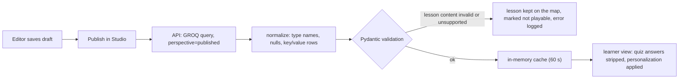

# Content schema

Editors work in Sanity Studio (`studio/`). The API reads **published** documents, validates them with
Pydantic (`api/src/peopleforce/modules/curriculum/schemas.py`) and serves learners a filtered view.
A bundled seed (`api/content/software-development.json`) has the same shape; it is used when
`CONTENT_SOURCE=local` and as the cold-start fallback.

```
Domain
 └─ Learning path ── achievements[], avatars[]
     └─ Chapter (theme, tier, blurb)
         └─ Lesson (minutes, xp, summary, output, parts[])
             ├─ blocks[]   what the learner sees, in order
             └─ actions[]  what the learner does; placed in blocks by key
```

## Sanity document types

| Type | Fields |
|---|---|
| `domain` | `title`, `slug` |
| `learningPath` | `title`, `slug`, `domain` → domain, `chapters[]` → chapter (ordered), `avatars[]`, `achievements[]` |
| `chapter` | `title`, `slug`, `theme` (yellow, blue, violet, green, orange, pink), `tier`, `blurb`, `lessons[]` → lesson (ordered) |
| `lesson` | `title`, `slug`, `minutes`, `xp`, `summary`, `output`, `parts[]`, `blocks[]`, `actions[]` |

Slugs are the stable ids used in URLs, progress rows and XP keys. **Do not change a slug after
publishing**: learners' progress is keyed by it. Order is the array order in the parent.
Blocks and actions are embedded objects inside the lesson, not separate documents.

A lesson with no blocks appears on the map as "Lesson coming soon".

## Block types

| Studio type | API `type` | Fields | Rendered as |
|---|---|---|---|
| `markdownBlock` | `markdown` | `key`, `title?`, `body` | Heading and Markdown text |
| `youtubeBlock` | `youtube` | `key`, `title`, `videoId` (11 chars) | Privacy-enhanced YouTube embed |
| `calloutBlock` | `callout` | `key`, `tone` (info, tip, warning), `title?`, `body`, `bodyBySpecialization[]` | Tinted note; body can differ per specialization |
| `resourcesBlock` | `resources` | `key`, `title?`, `links[] {label, url (https), description?}` | Link list |
| `actionGroupBlock` | `action_group` | `key`, `title?`, `intro?`, `actionKeys[]` | Card containing the listed actions |
| `quizBlock` | `quiz` | same as action group | Card containing a quiz action |
| `aiFeedbackBlock` | `ai_feedback` | same as action group | Card containing an AI review action |

Text fields accept Markdown (raw HTML is not rendered) and four placeholders filled from the
learner's quiz answers: `{{role}}`, `{{specialization}}`, `{{goal}}`, `{{channel}}`. Nothing else is
interpolated. The seed contains no video because no vetted video id was available; add one in Studio.

## Action definitions

Common fields: `key`, `title`, `instructions?`, `required`, `dependsOn[]`.

| Studio type | API `type` | Extra fields | Completion strategy | Status |
|---|---|---|---|---|
| `acknowledgeAction` | `acknowledge` | `confirmLabel` | `manual_confirmation` | implemented |
| `textSubmissionAction` | `text_submission` | `submitLabel`, `fields[] {name, label, help?, placeholder?, multiline, minLength, maxLength, examples[]}` | `valid_submission` | implemented |
| `quizAction` | `quiz` | `passingScore`, `questions[] {key, prompt, options[] {key, label}, correctOptionId, explanation?}` | `quiz_passing_score` | implemented |
| `aiReviewAction` | `ai_review` | `capability`, `sourceActionKey`, `submitLabel` | `ai_feedback_received` | implemented |
| `saveAssetAction` | `save_asset` | `assetType`, `sourceActionKey`, `submitLabel` | `asset_exists` | implemented |
| `externalTaskAction` | `external_task` | `targetCount` (1–20), `unit`, `tips[]` | `self_reported_count` | implemented |
| – | `publish_asset`, `resource_visit`, `conversation`, `document_submission` | – | `asset_published`, `user_approved_submission` | reserved, not implemented |

`capability` is the name of a backend AI capability (`ai-architecture.md`). Prompts are not stored in
content. `sourceActionKey` must point at a `text_submission` in the same lesson.

Maps (`examples`, `bodyBySpecialization`) are edited as rows of `{key, value}` because Sanity has no
map type; keys are quiz specialization values plus `default`.

## Achievements

`learningPath.achievements[]`: `key`, `title`, `description`, `trigger`:

| `trigger.type` | Field | Met when |
|---|---|---|
| `lesson_completed` | `lesson` → lesson | that lesson is completed |
| `lessons_completed_count` | `count` | that many lessons are completed |
| `asset_created` | `assetType` | an approved asset of that type exists |

Triggers are evaluated by the backend only (`gamification/service.py`).

## Publishing and validation



- **Drafts are never served**: the query uses Sanity's `published` perspective.
- **Per-lesson isolation**: one invalid lesson (unknown block type, broken reference, unimplemented
  completion strategy, duplicate keys) becomes "coming soon"; the rest of the path is unaffected.
- **Path-level errors** (no chapters, duplicate lesson slugs) reject the whole fetch; the previous good
  copy keeps being served.
- **Outage**: if Sanity cannot be reached, the last good copy is served; on a cold start the bundled
  seed is used; with neither, the API answers `503 content_unavailable`.
- **Latency**: edits appear within `CONTENT_CACHE_TTL_SECONDS` (60 s). There is no webhook yet.
- **Versioning**: see "Content versions" in `data-model.md`.

Checks enforced on every lesson: unique action keys; every block references existing actions; every
`dependsOn` / `sourceActionKey` exists and is not self-referential; every required action is placed in
a block; quiz `correctOptionId` is one of the options; field `minLength ≤ maxLength`.

## Setting up Sanity

1. Create a project at sanity.io (free plan) with a `production` dataset.
2. `cd studio && cp .env.example .env`, set `SANITY_STUDIO_PROJECT_ID`, then `npm install && npm run dev`.
3. Optional starting content: `npm run seed:export > seed.ndjson && npx sanity dataset import seed.ndjson production`.
4. Host the Studio with `npm run deploy` (Sanity-hosted) or keep it local.
5. In the API environment set `CONTENT_SOURCE=sanity` and `SANITY_PROJECT_ID`. A public dataset needs
   no token; a private one needs a read token in `SANITY_TOKEN`.

Not managed in the CMS yet: tour copy (`components/tour/steps.ts`), quiz questions
(`onboarding/quiz.py`), landing copy. See `decisions.md`.

## Daily challenges and the open-ended path

`learningPath.dailyChallenges[]`: `key`, `title`, `intro?`, `xp` (default 10), `action` (exactly one of
`externalTaskAction`, `acknowledgeAction`, `textSubmissionAction`, `quizAction`). The seed uses
`externalTaskAction` throughout: real-world tasks with a count, such as "Write to 5 potential clients"
(5 × "message sent", 30 XP) or "Apply to 3 job posts that fit your offer". Lesson-only action types (AI feedback,
save asset) are rejected by validation. Each learner gets one challenge per day in rotation; with an
empty list the card is simply not shown.

`learningPath.moreComing`: one line shown after the last level ("More coming soon").

**Coming-soon lessons**: publish the lesson with its title, summary, minutes, XP and parts but no
blocks. It appears on the map as a topic marked "Coming soon" and cannot be opened. The seed ships 20
lessons: the three in level 1 are playable, the other 17 are topics.

Keep lesson text short: every block is one screen in the player. Aim for a heading and a few lines per
Markdown block, and one idea per callout.
