# Data model

PostgreSQL is the source of truth for identity, onboarding, progress, rewards, assets and AI audit.
Editorial content is not copied into it (only immutable lesson snapshots, see below).
Models: `api/src/peopleforce/modules/*/models.py`. Migration: `api/alembic/versions/0001_initial_schema.py`.

```mermaid
erDiagram
  users ||--o{ sessions : has
  users ||--o| freelancer_profiles : has
  users ||--o{ freelancer_assets : owns
  users ||--o{ lesson_progress : has
  users ||--o{ action_attempts : makes
  users ||--o{ xp_events : earns
  users ||--o{ user_achievements : earns
  users ||--o{ tour_progress : has
  users ||--o{ ai_generations : triggers
  users ||--o{ onboarding_drafts : "claimed_by"
  onboarding_drafts ||--o{ magic_link_challenges : "bound to"

  users { uuid id PK
          string email UK
          timestamptz last_login_at }
  sessions { uuid id PK
             uuid user_id FK
             string token_hash UK
             timestamptz expires_at
             timestamptz revoked_at }
  magic_link_challenges { uuid id PK
                          string email
                          string token_hash UK
                          uuid onboarding_draft_id FK
                          timestamptz expires_at
                          timestamptz consumed_at }
  onboarding_drafts { uuid id PK
                      string token_hash UK
                      string status
                      jsonb answers
                      jsonb profile
                      uuid claimed_by_user_id FK
                      timestamptz expires_at }
  freelancer_profiles { uuid user_id PK
                        string avatar_key
                        string learning_path_id
                        string specialization
                        jsonb existing_assets }
  freelancer_assets { uuid id PK
                      uuid user_id FK
                      string asset_type
                      string source_lesson_id
                      string source_action_key
                      jsonb content
                      string status
                      string origin
                      int revision }
  lesson_progress { uuid id PK
                    uuid user_id FK
                    string lesson_id
                    string status
                    string content_version }
  action_attempts { uuid id PK
                    uuid user_id FK
                    string lesson_id
                    string action_key
                    jsonb payload
                    jsonb result
                    bool completed
                    string content_version }
  lesson_snapshots { string lesson_id PK
                     string version PK
                     jsonb payload }
  xp_events { uuid id PK
              uuid user_id FK
              int amount
              string idempotency_key }
  user_achievements { uuid user_id PK
                      string achievement_key PK }
  tour_progress { uuid user_id PK
                  string tour_key PK
                  string stage
                  string status }
  ai_generations { uuid id PK
                   uuid user_id FK
                   string capability
                   string prompt_version
                   string status
                   jsonb input
                   jsonb output }
```

## Tables

| Table | Purpose | Key constraints |
|---|---|---|
| `users` | One row per email (stored lower-cased). | `UNIQUE(email)` |
| `sessions` | Database-backed sessions; cookie holds the raw token. | `UNIQUE(token_hash)`, index `user_id` |
| `magic_link_challenges` | Single-use sign-in challenges. | `UNIQUE(token_hash)`, indexes `(email, created_at)`, `(request_ip, created_at)` for rate limits |
| `onboarding_drafts` | Anonymous quiz answers and derived profile. | `UNIQUE(token_hash)`, `CHECK status`, index `expires_at` |
| `freelancer_profiles` | Canonical professional profile, 1:1 with user. | PK `user_id` |
| `freelancer_assets` | Reusable content created by actions. | `UNIQUE(user_id, asset_type, source_lesson_id, source_action_key)`, `CHECK status`, `CHECK origin` |
| `lesson_progress` | State per user and lesson. | `UNIQUE(user_id, lesson_id)`, `CHECK status IN (in_progress, reward_pending, completed)` |
| `action_attempts` | Append-only log of accepted action submissions (this is also the "submissions" table). | index `(user_id, lesson_id, action_key, created_at)` |
| `lesson_snapshots` | Immutable copy of a published lesson per content hash. | PK `(lesson_id, version)` |
| `xp_events` | Immutable XP ledger. | `UNIQUE(user_id, idempotency_key)`, `CHECK amount > 0` |
| `user_achievements` | Earned achievements. | PK `(user_id, achievement_key)` |
| `activity_days` | One row per user and local day with learning activity; streaks are computed from it. | PK `(user_id, day)` |
| `daily_challenge_entries` | The learner's attempt at one day's challenge (payload, result, completed). | PK `(user_id, day)` |
| `tour_progress` | Tour state machine. | PK `(user_id, tour_key)`, `CHECK status` |
| `ai_generations` | Audit row per AI call, success or failure; also the usage-limit counter. | index `(user_id, created_at)` |

All user-owned tables reference `users(id) ON DELETE CASCADE`.

## Simplifications against the original table list

| Planned | Built | Why |
|---|---|---|
| `onboarding_answers` | JSONB column `onboarding_drafts.answers` | Seven fixed answers, always read together. |
| `submissions` | `action_attempts` | A submission is an attempt with a payload; one table, one history. |
| `achievements` | content (`LearningPath.achievements`) | Definitions are editorial data; only *earned* rows are relational. |
| `content_releases` | not built | `lesson_snapshots` keyed by content hash covers "do not lose what the learner saw". |
| `published_profiles`, `client_inquiries`, `subscription_entitlements` | not built | Outside the MVP. |

## JSONB payloads

| Column | Shape | Validated by |
|---|---|---|
| `onboarding_drafts.answers` | `{question_id: value \| [values]}` | `onboarding/quiz.py::validate_answer` on every write |
| `onboarding_drafts.profile` | `PersonalizationProfile` | Adaptix `Retort` |
| `action_attempts.payload` | per action type, e.g. `{"values": {...}}`, `{"answers": {...}}` | action handler |
| `action_attempts.result` | per action type, e.g. quiz score, AI feedback, asset id | action handler |
| `freelancer_assets.content` | `{"fields": [{name, label, value}]}` or `{platform, title, body, notes}` | handler / Pydantic output model |
| `ai_generations.input/output` | model context and validated output | capability output model |

## Transactions and idempotency

| Operation | Guarantee | Mechanism |
|---|---|---|
| Verify magic link | Link used at most once; user, draft claim, profile and session commit together. | `UPDATE … WHERE consumed_at IS NULL AND expires_at > now() RETURNING` in one transaction |
| Create account | One account per email under concurrency. | `INSERT … ON CONFLICT (email) DO NOTHING` then select |
| Claim draft | One owner. | conditional `UPDATE … WHERE claimed_by_user_id IS NULL` |
| Complete lesson | Serialized per lesson; repeat calls return the existing result. | `SELECT … FOR UPDATE` on `lesson_progress` (and on the profile for the first lesson) |
| Pay XP | Once per lesson per user, whatever the number of calls. | `INSERT … ON CONFLICT (user_id, idempotency_key) DO NOTHING`, key `lesson:<id>:completed` |
| Select avatar + pay pending reward | Atomic: avatar, XP, completion and achievements together or not at all. | one transaction, profile row locked first |
| Daily challenge | One entry per user and day; XP once per day under concurrent submits. | insert-or-ignore then `SELECT … FOR UPDATE` on the entry; ledger key `daily:<date>` |
| Record activity day | Idempotent. | `INSERT … ON CONFLICT DO NOTHING` |
| Grant achievement | Once. | composite primary key + `ON CONFLICT DO NOTHING` |
| Save asset | One asset per source action; a change bumps `revision`. | unique constraint + row lock |

Migrations: `0001_initial_schema`, `0002_streaks_daily_challenges_timezone` (adds the two tables above
and `freelancer_profiles.timezone`). Ranks are not stored: they are a pure function of the XP total
(`gamification/ranks.py`).

Lock order is always profile → lesson progress, so completion and avatar selection cannot deadlock.
Rate-limit windows are computed with the database clock (`now()`), because `created_at` is written by it.

Verified by `api/tests/test_first_run_flow.py::test_xp_is_paid_once_under_repeats_and_concurrency`
(five concurrent avatar calls and five concurrent completes produce exactly one XP row).

## Content versions

`Lesson.version` is the first 16 hex characters of the SHA-256 of the validated lesson. When a learner
starts a lesson, the lesson is stored once in `lesson_snapshots` under that version, and every
`lesson_progress` / `action_attempts` row records the version it was made against. Editing a lesson in
the CMS therefore never invalidates a completed lesson: completion is a stored fact, and the content it
referred to remains readable.
