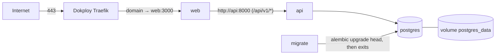

# Deployment

Target: Dokploy with Docker Compose on one server. Files: `docker-compose.yml`, `Dockerfile` (web),
`api/Dockerfile`, `.env.example`.

## Topology



| Service | Image | Exposed | Health check | Restart |
|---|---|---|---|---|
| `postgres` | `postgres:17-alpine` | internal 5432 only | `pg_isready` | unless-stopped |
| `migrate` | `./api` | – | exits 0 | no |
| `api` | `./api` (uvicorn, 2 workers, no reloader, non-root) | internal 8000 only | `GET /api/v1/health` (includes a DB round trip) | unless-stopped |
| `web` | `./` (Next.js standalone, non-root) | internal 3000, routed by Dokploy | `GET /` | unless-stopped |

Start order is enforced: `postgres` healthy → `migrate` completed successfully → `api` healthy → `web`.

## Reverse proxy assumptions

- Dokploy's Traefik terminates TLS and routes the domain to `web` on port **3000**. Nothing else is routed.
- The browser calls `/api/v1/*` on the same origin; Next.js forwards it to `http://api:8000`
  (`API_INTERNAL_URL`, a **build argument** because rewrites are resolved at build time).
- `X-Forwarded-For` is passed through and used for per-IP rate limiting.
- `PUBLIC_BASE_URL` must be the exact public origin (scheme + host). It is used to build magic links,
  to decide whether cookies are `Secure`, and by the Origin check. A wrong value makes every write
  request fail with `403 forbidden_origin`.

## Setup in Dokploy

1. Create a project → **Compose** service → connect the Git repository, compose path `docker-compose.yml`.
2. **Environment**: paste `.env.example` and fill it in. Required: `POSTGRES_PASSWORD`, `PUBLIC_BASE_URL`.
3. **Domains**: add `peopleforce.site` to service `web`, container port `3000`, HTTPS on (Let's Encrypt).
   DNS: an `A` record for `peopleforce.site` pointing at the server. For `www.peopleforce.site`, add a second
   record and a redirect to the apex in Dokploy, so the site has exactly one origin (cookies and the Origin
   check are tied to `PUBLIC_BASE_URL`).
4. Deploy. Dokploy builds both images, runs `migrate`, then starts `api` and `web`.
5. Check `https://peopleforce.site/api/v1/health` → `{"status":"ok","database":"up"}`. API docs: `/api/v1/docs`.

## Environment variables

| Variable | Used by | Required | Notes |
|---|---|---|---|
| `POSTGRES_PASSWORD` | postgres, api | yes | Database password. `POSTGRES_USER` / `POSTGRES_DB` default to `peopleforce`. |
| `PUBLIC_BASE_URL` | api | yes | `https://peopleforce.site` in production, no trailing slash. |
| `EMAIL_PROVIDER` | api | – | `resend` (default in compose) or `console` (prints the link to the API log). |
| `RESEND_API_KEY` | api | with `resend` | Resend API key. |
| `EMAIL_FROM` | api | with `resend` | Sender on a domain verified in Resend. |
| `CONTENT_SOURCE` | api | – | `local` (default) or `sanity`. |
| `SANITY_PROJECT_ID`, `SANITY_DATASET`, `SANITY_TOKEN` | api | with `sanity` | Token only for a private dataset. |
| `LLM_PROVIDER` | api | – | `none` (default), `gemini`, `anthropic`. |
| `LLM_MODEL` | api | – | e.g. `gemini-3.5-flash-lite`. |
| `GEMINI_API_KEY` / `ANTHROPIC_API_KEY` | api | with that provider | |
| `LANGFUSE_PUBLIC_KEY`, `LANGFUSE_SECRET_KEY`, `LANGFUSE_HOST` | api | – | Prompt management and tracing. |
| `POSTHOG_API_KEY`, `POSTHOG_HOST` | api + web build | – | Project key; also baked into the web image as `NEXT_PUBLIC_POSTHOG_KEY`. Changing it needs a rebuild. |

More API settings with defaults (`api/src/peopleforce/core/config.py`): `SESSION_TTL_DAYS` (30),
`MAGIC_LINK_TTL_MINUTES` (15), `MAGIC_LINK_MIN_INTERVAL_SECONDS` (30),
`MAGIC_LINK_MAX_PER_EMAIL_PER_HOUR` (5), `MAGIC_LINK_MAX_PER_IP_PER_HOUR` (30),
`ONBOARDING_DRAFT_TTL_DAYS` (14), `CONTENT_CACHE_TTL_SECONDS` (60), `AI_DAILY_LIMIT_PER_USER` (30),
`LLM_TIMEOUT_SECONDS` (45). To override one in production, add it to the `api_env` block in
`docker-compose.yml`.

Secrets live only in Dokploy's environment settings. `.env*` files are git-ignored except `.env.example`.

## External services

| Service | Setup | Webhooks |
|---|---|---|
| Resend | Verify `peopleforce.site` as a sending domain (SPF/DKIM DNS records) and set `EMAIL_FROM=PeopleForce <hello@peopleforce.site>`; create an API key. **Turn off click tracking** for the domain, or Resend rewrites the sign-in link through its redirect. | none |
| Sanity | Project + `production` dataset; see `content-schema.md`. | none (content is polled, 60 s cache) |
| PostHog | Cloud project; copy the project API key. | none |
| Langfuse | Cloud project; create prompts named like the files in `api/src/peopleforce/modules/ai/prompts/` with label `production`. | none |
| Gemini / Anthropic | API key. | none |

No webhook URLs are required by this version.

## Migrations

- Alembic, async engine, revisions in `api/alembic/versions/`.
- In production the `migrate` service is the **only** process that runs `alembic upgrade head`. The API
  never migrates on startup, so two API workers cannot race.
- A failed migration stops the deployment before the new API starts (`service_completed_successfully`).
- New revision: `cd api && uv run alembic revision --autogenerate -m "message"`; review the file; commit.
- `uv run alembic check` fails if models and migrations have drifted.

## Data safety

- Database files live in the named volume `postgres_data`. Rebuilds, redeploys and container restarts
  keep it. Only `docker compose down -v` (or deleting the volume in Dokploy) removes it. Do not use `-v`.
- PostgreSQL is not published on any host port.
- Back up with `docker compose exec postgres pg_dump -U peopleforce peopleforce > backup.sql`
  (Dokploy can schedule this).

## Run the production stack locally

```bash
cp .env.example .env     # set POSTGRES_PASSWORD, PUBLIC_BASE_URL=http://localhost:3200, EMAIL_PROVIDER=console
docker compose -f docker-compose.yml -f docker-compose.local.yml up --build
# open http://localhost:3200 ; the sign-in link is printed in `docker compose logs api`
```

## Local development

```bash
docker compose -f docker-compose.dev.yml up -d          # PostgreSQL on localhost:5433
cd api && cp .env.example .env && uv sync
uv run alembic upgrade head
uv run uvicorn peopleforce.main:app_factory --factory --port 8000 --reload --reload-dir src
# second terminal, repo root:
npm install && npm run dev                              # http://localhost:3000
```

`PUBLIC_BASE_URL` in `api/.env` must match the port the web app runs on. With
`EMAIL_PROVIDER=console` outside production, the "check your inbox" screen shows the sign-in link.

## Checks

| Command | What it verifies |
|---|---|
| `cd api && uv run pytest` | API, auth, progression and content tests against real PostgreSQL (schema built by Alembic) |
| `cd api && uv run ruff check src tests alembic` | Python lint |
| `cd api && uv run alembic check` | models and migrations agree |
| `npm run lint && npm run typecheck && npm run build` | web lint, types, production build |
| `npm run test:e2e` | Playwright first-run journey (needs the dev stack running, see `playwright.config.ts`) |
| `docker compose config -q` | compose file is valid |

## PostHog MCP (for the team's AI tooling)

`.mcp.json` at the repo root registers PostHog's hosted MCP server (`https://mcp.posthog.com/mcp`) for
Claude Code. It holds no secret: each person signs in through OAuth the first time (run `/mcp` in
Claude Code and choose `posthog`). Use the EU endpoint instead if the PostHog project is in the EU region.
With it, the assistant can read events, build the activation funnel from `implementation-plan.md`,
and manage feature flags in the PostHog project.
