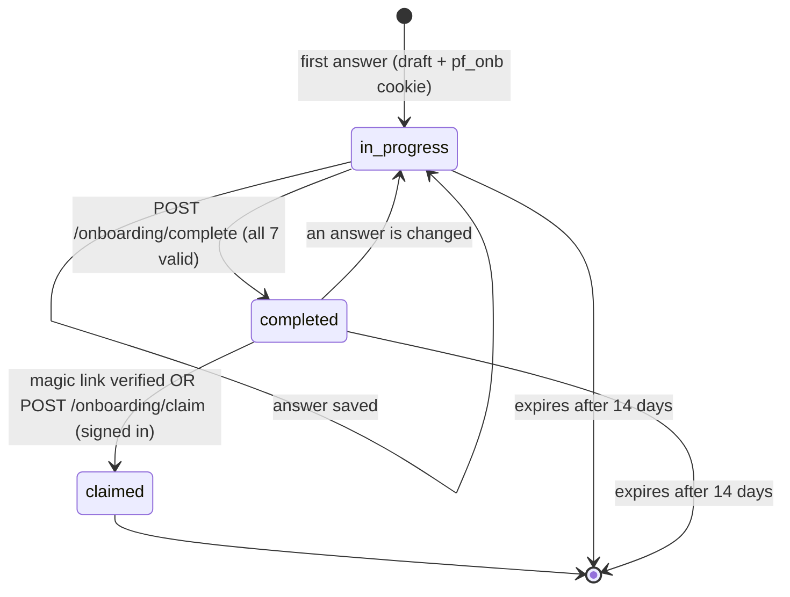
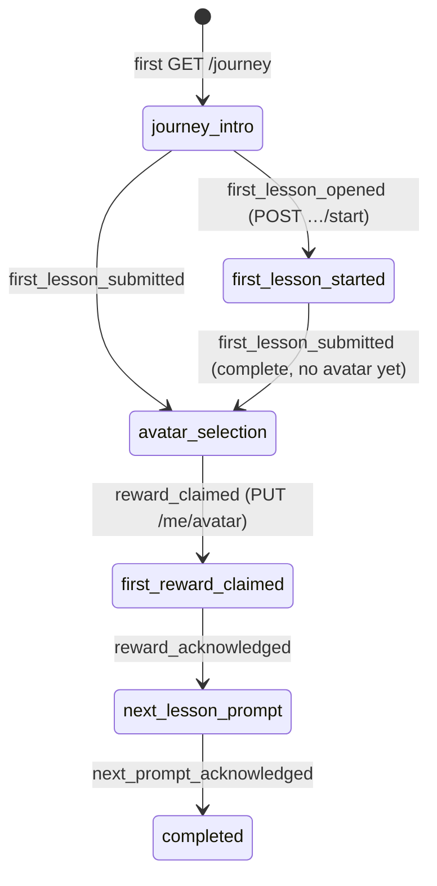

# User flow

```
Landing → 7-question quiz → journey preview → email → magic link → confirm
        → journey map (tour 1) → first lesson (tour 2) → finish lesson
        → avatar (tour 3) → XP celebration (tour 4) → next lesson prompt (tour 5) → tour completed
```

Every arrow is backed by a row in PostgreSQL, so a refresh, a closed tab, a logout or a different device
resumes at the same point. `e2e/first-run.spec.ts` walks this flow and reloads at every stage.

| Step | Route | State written |
|---|---|---|
| Landing CTA | `/` → `/start` | – (PostHog `landing_cta_clicked`) |
| Quiz | `/start` | `onboarding_drafts.answers` after every answer; browser holds cookie `pf_onb` (opaque token) |
| Preview | `/start/plan` | draft `status = completed`, `profile` JSONB |
| Email | `/start/plan` | `magic_link_challenges` row bound to the draft |
| Confirm | `/auth/verify` | challenge consumed, `users`, `sessions`, draft claimed, `freelancer_profiles` |
| Journey | `/journey` | `tour_progress` created at `journey_intro` |
| Lesson | `/journey/lessons/:id` | `lesson_progress`, `action_attempts`, `freelancer_assets` |
| Avatar + XP | dialog | `freelancer_profiles.avatar_key`, `xp_events`, `user_achievements` |

## Anonymous quiz → account (identity linking)



- The browser stores only an opaque random token (HttpOnly cookie); the database stores its hash.
  Answers never appear in a URL or in the email.
- When a magic link is requested, the *completed* draft found through the cookie is bound to the
  challenge row (`onboarding_draft_id`). The link carries only the challenge token, so opening it on a
  phone still attaches the quiz taken on a laptop.
- Claiming is a single conditional `UPDATE ... WHERE status = 'completed' AND claimed_by_user_id IS NULL`.
  Of any number of concurrent or repeated attempts, one matches. A second account that verifies a link
  bound to an already-claimed draft signs in without a profile and is sent back to the quiz.
- Accounts are created with `INSERT ... ON CONFLICT (email) DO NOTHING`; emails are stored lower-cased,
  so one address is one account.
- A user who retakes the quiz while signed in keeps progress, XP and avatar; only the quiz-derived
  profile fields are refreshed.

## Magic link

```mermaid
sequenceDiagram
  participant U as Browser
  participant A as API
  participant R as Resend
  U->>A: POST /auth/magic-link {email} (+ pf_onb cookie)
  A->>A: rate limits, create challenge (hash, 15 min, draft id)
  A->>R: send email with /auth/verify?token=…
  A-->>U: 202 {email_masked} (same answer for new and existing emails)
  Note over U: user (or a mail scanner) opens the link
  U->>A: POST /auth/magic-link/inspect {token}
  A-->>U: valid | expired | used | invalid (nothing consumed)
  Note over U: token removed from the address bar (history.replaceState)
  U->>A: POST /auth/magic-link/verify {token} (button press)
  A->>A: one transaction: consume, upsert user, claim draft, upsert profile, create session
  A-->>U: Set-Cookie pf_session; {redirect: "/journey"}
```

| Case | Behaviour |
|---|---|
| Scanner prefetch | GET of the page and `inspect` consume nothing. |
| Reused link | `410 link_used`. If this browser is already signed in, it just goes to `/journey`. |
| Expired link | `410 link_expired`, button to request a new one. |
| Too many requests | `429 rate_limited` with `Retry-After` (30 s between emails, 5 per hour per address, 30 per hour per IP). |
| Resend down | `503 email_delivery_failed`; the unsent challenge is deleted so it does not count against the limit. |
| Refresh on "check your inbox" | State is restored from `sessionStorage` for this tab. |

## First-run tour state machine

Stored in `tour_progress` (`tour_key = 'first_run'`), implemented in `modules/tours/service.py`.



`status` is separate: `active`, `skipped` (event `skip`), `completed`. `replay` reactivates the tour at
the stage the learning facts allow.

| Stage | Where | Presentation | Advances when |
|---|---|---|---|
| `journey_intro` | `/journey` | Driver.js highlight on `data-tour="current-checkpoint"` | learner opens the first lesson |
| `first_lesson_started` | first lesson | highlight on `data-tour="lesson-exercise"` ("Got it" only hides it) | lesson is finished |
| `avatar_selection` | any signed-in route | avatar dialog | avatar saved |
| `first_reward_claimed` | any signed-in route | celebration dialog | "Continue" |
| `next_lesson_prompt` | `/journey` | highlight on the new current checkpoint | acknowledged or next lesson opened |

Rules that keep it recoverable:

- **Events are semantic and idempotent.** An event that does not match the current stage is a no-op.
- **Server events are not trusted to the client.** `first_lesson_submitted` and `reward_claimed` are
  emitted inside the completion and avatar transactions.
- **Reconciliation.** Every read re-derives a minimum stage from facts (`reward_pending` ⇒ at least
  `avatar_selection`; first lesson completed ⇒ at least `first_reward_claimed`), so a lost event cannot
  leave the tour behind reality.
- **The tour never gates anything.** Avatar and reward dialogs are driven by `lesson_progress`, not by
  the tour; with the tour skipped they still appear, with neutral wording.
- **Anchors** are stable `data-tour` names (`components/tour/steps.ts`), never CSS selectors or coordinates.

## Avatar and XP ordering

1. `POST …/complete` on the first lesson with no avatar → `lesson_progress.status = reward_pending`.
   The submission and asset are already committed. No XP row exists yet.
2. `GET /journey` reports `pending_reward_lesson_id`; the shell shows the avatar dialog on whatever
   signed-in route the learner is on, on any device.
3. `PUT /me/avatar` → one transaction: avatar saved, XP event inserted (idempotent key), lesson
   `completed`, achievements granted, tour → `first_reward_claimed`.
4. The celebration shows the reward returned by that call; after a refresh it is rebuilt from the ledger
   (`last_reward`) until the learner presses Continue.
5. Every later lesson pays XP inside `POST …/complete` directly.

Interruption points: before step 3 nothing is lost and the dialog returns; after step 3 the reward is
already paid and repeated calls pay nothing.

## After the first run: daily loop, ranks, profile

| Element | Where | Rule |
|---|---|---|
| **Lesson player** | `/journey/lessons/:id` | One step per screen: each content block and each action is its own step, and a text exercise asks one question at a time. A required step must be done before "Continue"; an optional one shows "Skip". Reopening a lesson resumes at the first required step still open. |
| **Daily challenge** | card on `/journey` (appears once the learner has an avatar) | One real-world task per learner per local day ("Write to 5 potential clients"), picked by rotation from `daily_challenges`. The learner ticks a box per unit done; partial progress is saved and survives a reload. Reaching the target pays the challenge's XP once (`daily:<date>`) and counts the day; then it is closed until tomorrow. |
| **Streak** | flame in the top bar, profile page | Consecutive local days with activity. A day counts when a lesson action is completed, a lesson is finished, or the daily challenge is done. The streak survives until the end of the next day. |
| **Rank** | top bar, celebration, profile page | Derived from total XP: Newcomer 0, Explorer 40, Builder 120, Specialist 250, Professional 450, Expert 700, Independent 1000. Called "rank" because chapters on the map are already "levels". |
| **Profile** | `/journey/profile`, opened from the avatar in the top bar | Change character, XP bar to the next rank, rank ladder, streak with the last seven days, achievements (earned and locked), saved assets, sign out. |
| **Reward moment** | celebration dialog, then a note | Confetti, the character on a sunburst, XP counting up and the rank bar filling. After "Continue" (and after closing a finished daily challenge) a small self-dismissing note shows overall progress: total XP and XP left to the next rank. All motion is off under `prefers-reduced-motion`. |
| **Next up** | card at the top of `/journey` | The button opens the lesson directly and is labelled by state: "Start lesson", "Continue lesson", "Claim your reward", or disabled "Coming soon". |
| **Open-ended path** | end of the map | 20 steps are published as topics; 3 are playable, the rest read "Coming soon". The map ends with "More coming soon" and the path's `more_coming` line, not a finish line. |

The learner's "day" follows their own time zone: the browser reports its IANA zone once
(`PUT /me/timezone`), stored on the profile. Unknown zones fall back to UTC.
